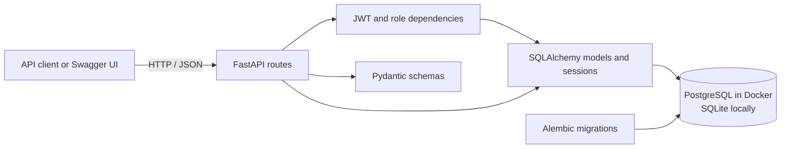

# SupportDesk API

A role-aware REST API for customer support workflows. Customers can create and
track their own tickets, while agents and administrators can manage ticket
work, assignments, and comments. The project includes JWT authentication,
role-based access control, database migrations, automated tests, and a Docker
Compose setup.

## Features

- Customer registration and JWT Bearer authentication.
- Ticket creation, filtering, pagination, and role-aware updates.
- Ticket comments and agent assignment.
- Customer, agent, and administrator roles.
- Interactive API documentation with Swagger UI and ReDoc.
- SQLAlchemy persistence and versioned Alembic migrations.

## Tech stack

| Area | Technology |
| --- | --- |
| Language | Python 3.12 |
| API | FastAPI, Pydantic |
| Persistence | SQLAlchemy 2.x |
| Production/container database | PostgreSQL 15 |
| Local default database | SQLite |
| Migrations | Alembic |
| Authentication | JWT Bearer tokens |
| Testing | pytest, FastAPI TestClient, pytest-cov |
| Containerization | Docker, Docker Compose |

## Architecture



The API is organized into route handlers, shared authentication/database
dependencies, Pydantic request/response schemas, SQLAlchemy models, and Alembic
migrations. Customers can access only their own tickets; agents and
administrators have broader ticket access, and selected management operations
are restricted by role.

## Requirements

- Python 3.12 or newer for local development.
- Docker Desktop with Docker Compose v2 for the container workflow.

## Local installation and setup

The local application defaults to a SQLite database at `./supportdesk.db`.
PostgreSQL is not required for local development.

1. Create and activate a virtual environment:

   **Windows PowerShell**

   ```powershell
   py -3.12 -m venv venv
   .\venv\Scripts\Activate.ps1
   ```

   **macOS / Linux**

   ```sh
   python3.12 -m venv venv
   source venv/bin/activate
   ```

2. Install dependencies:

   ```sh
   python -m pip install --upgrade pip
   python -m pip install -r requirements.txt
   ```

3. Set a strong signing key in your environment or `.env` file. For example,
   generate a value with:

   ```sh
   python -c "import secrets; print(secrets.token_urlsafe(32))"
   ```

   `SECRET_KEY` must contain at least 32 characters. If it is omitted during
   local development, the application generates a temporary key at startup;
   tokens issued with that key will stop working after a restart.

4. Apply database migrations and start the development server:

   ```sh
   alembic upgrade head
   uvicorn app.main:app --reload
   ```

The API is available at `http://localhost:8000`. Interactive Swagger UI is at
`http://localhost:8000/docs`, ReDoc at `http://localhost:8000/redoc`, and the
OpenAPI document at `http://localhost:8000/openapi.json`.

## Docker Compose

Copy the example environment file, then set non-empty values for
`POSTGRES_PASSWORD` and `SECRET_KEY`:

```sh
cp .env.example .env
```

Generate a signing key with
`python -c "import secrets; print(secrets.token_urlsafe(32))"` and a URL-safe
PostgreSQL password with
`python -c "import secrets; print(secrets.token_urlsafe(24))"`. The Compose
configuration embeds the PostgreSQL password in a database URL, so avoid
characters that require URL-encoding. Do not commit `.env`.

Build and start PostgreSQL and the API:

```sh
docker compose up --build
```

Compose waits for PostgreSQL's health check. The API container runs
`alembic upgrade head` before starting Uvicorn on port `8000`. PostgreSQL data
is persisted in the `postgres_data` volume. Stop the services with
`Ctrl+C`; use `docker compose down` to remove the containers while preserving
the named database volume.

## Environment variables

Environment variable names are case-insensitive. Values in `.env.example` are
placeholders; configure secrets locally and keep `.env` out of version control.

| Variable | Required | Default | Purpose |
| --- | --- | --- | --- |
| `SECRET_KEY` | Docker: yes; local: recommended | Random temporary key | JWT signing key; at least 32 characters |
| `ALGORITHM` | No | `HS256` | JWT signing algorithm (`HS256`, `HS384`, or `HS512`) |
| `ACCESS_TOKEN_EXPIRE_MINUTES` | No | `60` | JWT lifetime in minutes; must be positive |
| `DATABASE_URL` | No | `sqlite:///./supportdesk.db` | SQLAlchemy connection URL for the API and Alembic |
| `TEST_DATABASE_URL` | No | In-memory SQLite | Optional database URL for tests; Compose test profile supplies PostgreSQL |
| `POSTGRES_USER` | Docker: yes | `supportdesk` in `.env.example` | PostgreSQL user used by Compose |
| `POSTGRES_PASSWORD` | Docker: yes | Empty in `.env.example` | PostgreSQL password used by Compose; set a strong value |
| `POSTGRES_DB` | Docker: yes | `supportdesk` in `.env.example` | PostgreSQL database created by Compose |
| `POSTGRES_PORT` | No | `5432` | Host port mapped to PostgreSQL |
| `API_PORT` | No | `8000` | Host port mapped to the API |

The Compose API container constructs its PostgreSQL URL from `POSTGRES_USER`,
`POSTGRES_PASSWORD`, and `POSTGRES_DB`; the local process instead uses
`DATABASE_URL` or the SQLite default.

## API endpoints

All request and response bodies use JSON except for the Bearer token header.
Protected endpoints require `Authorization: Bearer <access_token>`. Obtain a
token from `POST /auth/login`; in Swagger UI, use **Authorize** and paste the
returned `access_token`.

| Method | Endpoint | Access | Success | Purpose |
| --- | --- | --- | --- | --- |
| `POST` | `/auth/register` | Public | `201` | Register a customer account |
| `POST` | `/auth/login` | Public | `200` | Validate credentials and return a JWT |
| `GET` | `/users/me` | Authenticated | `200` | Get the current user's profile |
| `GET` | `/users/` | Agent, admin | `200` | List users |
| `PATCH` | `/users/{user_id}/role` | Admin | `200` | Change a user's role |
| `POST` | `/tickets` | Authenticated | `201` | Create a ticket owned by the current user |
| `GET` | `/tickets` | Authenticated | `200` | List accessible tickets; supports `status`, `priority`, `skip`, and `limit` filters |
| `GET` | `/tickets/{ticket_id}` | Authenticated | `200` | Retrieve an accessible ticket |
| `PATCH` | `/tickets/{ticket_id}` | Authenticated | `200` | Update an accessible ticket; customers can only close their own open tickets |
| `PATCH` | `/tickets/{ticket_id}/assign` | Agent, admin | `200` | Assign to an active agent or clear the assignment |
| `POST` | `/tickets/{ticket_id}/comments` | Authenticated | `201` | Add a comment to an accessible ticket |
| `GET` | `/tickets/{ticket_id}/comments` | Authenticated | `200` | List comments on an accessible ticket |
| `GET` | `/health` | Public | `200` | Check API and database connectivity |

Authentication failures return `401`, role or ownership restrictions return
`403`, missing resources return `404`, and invalid request data returns `422`.
Registration returns `400` when the email address is already registered.
Assignment also returns `422` if the selected assignee is not an active agent.

### Ticket filters and permissions

- `status`: `OPEN`, `IN_PROGRESS`, `RESOLVED`, or `CLOSED`.
- `priority`: `LOW`, `MEDIUM`, `HIGH`, or `URGENT`.
- `skip`: number of records to skip (default `0`).
- `limit`: page size from `1` to `100` (default `100`).
- Customers see and comment on their own tickets. Agents and administrators
  can access all tickets. Agents and administrators can assign tickets;
  administrators can also manage user roles.

## Testing

Run the full suite locally:

```sh
pytest
```

By default, tests use an isolated in-memory SQLite database and roll back an
outer transaction after each test. To run the integration suite against a
separate PostgreSQL test database using Compose, first configure `.env` as
described above, then run:

```sh
docker compose --profile test run --build --rm test
```

The test profile starts a separate `supportdesk_test` PostgreSQL database and
volume; it does not use the application database volume.

## Database migrations

The application does not create or update the database schema automatically.
Run migrations before starting the API:

```sh
alembic upgrade head
```

To generate a migration after changing SQLAlchemy models, set the desired
`DATABASE_URL`, then run and review:

```sh
alembic revision --autogenerate -m "describe the schema change"
alembic upgrade head
```

Other useful commands:

```sh
alembic current
alembic history
alembic downgrade -1
```

Review autogenerated migration scripts before applying them, especially for
data migrations or changes that may drop existing data.

## Security notes

- Never commit `.env`, production credentials, or real signing keys.
- `.env.example` is a placeholder template and contains no usable secrets.
- Use a unique, high-entropy `SECRET_KEY` outside local throwaway development.
- Passwords are hashed; token validation and role checks are enforced by
  protected API dependencies.
